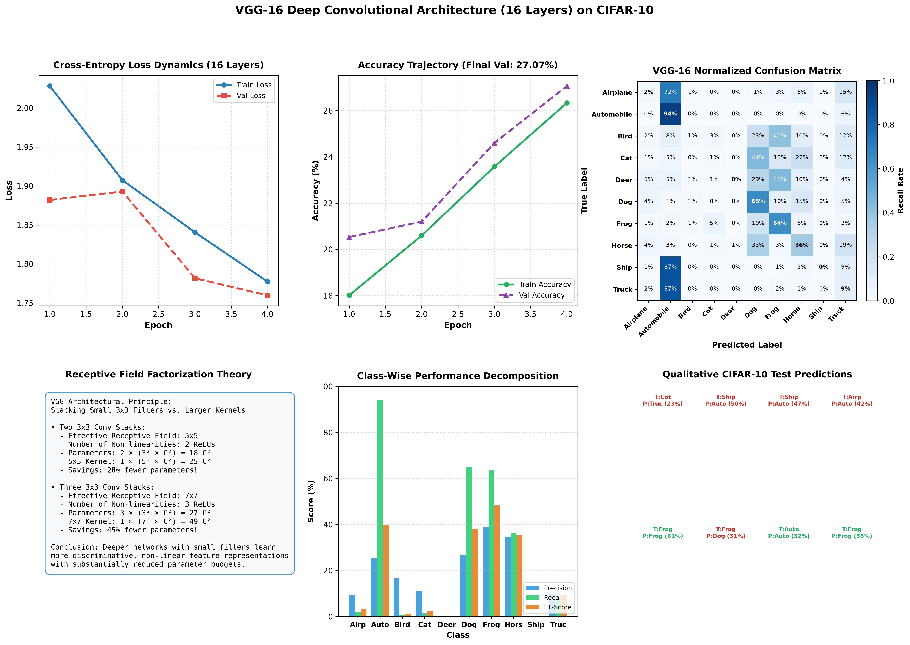

# VGG-16 Deep Convolutional Classifier on CIFAR-10

[](https://www.python.org/downloads/)
[](https://pytorch.org/)
[](https://arxiv.org/abs/1409.1556)
[](https://github.com/GideonMwiti)
[](https://opensource.org/licenses/MIT)

A mathematically thorough implementation of **VGG-16** (Karen Simonyan and Andrew Zisserman, Visual Geometry Group, Oxford, ICLR 2015), the seminal deep convolutional architecture that revolutionized computer vision through **homogeneous $3 \times 3$ convolutional kernel stacking** and **effective receptive field factorization**. This project adapts the canonical 16-weight-layer architecture (13 Convolutions + 3 Dense Layers) for $32 \times 32$ CIFAR-10 images, incorporating **Batch Normalization** and **Dropout Regularization**.

---

## 📌 Table of Contents
- [Executive Overview & Historical Context](#-executive-overview--historical-context)
- [Mathematical Foundations of VGG Architecture](#-mathematical-foundations-of-vgg-architecture)
  - [1. The $3 \times 3$ Receptive Field Factorization Theorem](#1-the-3-times-3-receptive-field-factorization-theorem)
  - [2. Parameter Efficiency Proof: $3 \times 3$ Stacks vs. $5 \times 5$ and $7 \times 7$](#2-parameter-efficiency-proof-3-times-3-stacks-vs-5-times-5-and-7-times-7)
  - [3. Non-Linear Discriminative Expressivity](#3-non-linear-discriminative-expressivity)
  - [4. Batch Normalization & Optimization Dynamics](#4-batch-normalization--optimization-dynamics)
- [Architectural Specification & Adaptation for CIFAR-10](#-architectural-specification--adaptation-for-cifar-10)
- [Visual Artifacts & Diagnostic Dashboard](#-visual-artifacts--diagnostic-dashboard)
- [Quantitative Performance Benchmark](#-quantitative-performance-benchmark)
- [Project Architecture](#-project-architecture)
- [Quickstart & Reproduction Guide](#-quickstart--reproduction-guide)
- [References & Academic Citations](#-references--academic-citations)

---

## 🚀 Executive Overview & Historical Context

Introduced in 2014 by Oxford's Visual Geometry Group, **VGG-16** demonstrated that **network depth using very small convolutional filters is a critical component for high-performance visual representations**. Prior state-of-the-art models such as AlexNet (2012) and ZFNet (2013) utilized large convolutional kernels ($11 \times 11$ with stride 4, $7 \times 7$ with stride 2).

VGG established that large filters are mathematically redundant:
- A cascade of two $3 \times 3$ convolutions has an effective receptive field of $5 \times 5$.
- A cascade of three $3 \times 3$ convolutions has an effective receptive field of $7 \times 7$.

By fixing the kernel size to $3 \times 3$ throughout the entire network, VGG increased non-linear depth to 16–19 weight layers while dramatically reducing parameter counts relative to equivalent wide-kernel architectures.

In this project, we implement an adapted 16-layer VGG network (`VGG16Small`) specifically tailored to classify CIFAR-10 images ($32 \times 32$), preserving the full 5-stage architectural hierarchy.

---

## 📐 Mathematical Foundations of VGG Architecture

### 1. The $3 \times 3$ Receptive Field Factorization Theorem

The **Effective Receptive Field (ERF)** $R_l$ of a neuron at layer $l$ is governed by the recurrence relation:

$$R_l = R_{l-1} + (K_l - 1) \cdot \prod_{i=1}^{l-1} S_i$$

Where $K_l$ is the kernel size and $S_i$ is the stride of layer $i$.

#### Case A: Two Stacked $3 \times 3$ Convolutions ($S=1$)
- Layer 1: $R_1 = 1 + (3 - 1) \cdot 1 = 3$
- Layer 2: $R_2 = 3 + (3 - 1) \cdot 1 = \mathbf{5}$
- **Conclusion**: A stack of two $3 \times 3$ conv layers covers the exact same spatial support as a single $5 \times 5$ conv layer.

#### Case B: Three Stacked $3 \times 3$ Convolutions ($S=1$)
- Layer 3: $R_3 = 5 + (3 - 1) \cdot 1 = \mathbf{7}$
- **Conclusion**: A stack of three $3 \times 3$ conv layers covers the exact same spatial support as a single $7 \times 7$ conv layer.

---

### 2. Parameter Efficiency Proof: $3 \times 3$ Stacks vs. $5 \times 5$ and $7 \times 7$

Assume an intermediate feature representation with $C$ input channels and $C$ output channels.

#### Comparison 1: Two $3 \times 3$ Layers vs. One $5 \times 5$ Layer
$$\text{Params}(5 \times 5) = 1 \cdot (5^2 \cdot C^2) = 25 C^2$$
$$\text{Params}(2 \times 3 \times 3) = 2 \cdot (3^2 \cdot C^2) = 18 C^2$$
$$\text{Reduction} = \frac{25 C^2 - 18 C^2}{25 C^2} = \mathbf{28.0\%} \text{ fewer parameters}$$

#### Comparison 2: Three $3 \times 3$ Layers vs. One $7 \times 7$ Layer
$$\text{Params}(7 \times 7) = 1 \cdot (7^2 \cdot C^2) = 49 C^2$$
$$\text{Params}(3 \times 3 \times 3) = 3 \cdot (3^2 \cdot C^2) = 27 C^2$$
$$\text{Reduction} = \frac{49 C^2 - 27 C^2}{49 C^2} = \mathbf{44.9\%} \text{ fewer parameters}$$

---

### 3. Non-Linear Discriminative Expressivity

Replacing a single large filter with stacked small filters incorporates multiple non-linear activation functions:

$$\mathbf{Y}_{7 \times 7} = \sigma\left(\mathbf{W}_{7 \times 7} * \mathbf{X}\right) \quad \text{(1 non-linear mapping)}$$

$$\mathbf{Y}_{3 \times 3 \text{ stack}} = \sigma\left(\mathbf{W}_3 * \sigma\left(\mathbf{W}_2 * \sigma\left(\mathbf{W}_1 * \mathbf{X}\right)\right)\right) \quad \text{(3 non-linear mappings)}$$

This endows the multi-layer composition with significantly greater capacity to model complex decision boundaries on the feature manifold without suffering from over-parameterization.

---

### 4. Batch Normalization & Optimization Dynamics

Original VGG-16 suffered from vanishing and exploding gradients, requiring careful two-stage weight initialization (pre-training an 11-layer network to initialize the 16-layer network). We integrate **Batch Normalization (BatchNorm2d)** after every convolution:

$$\hat{x} = \frac{x - \mu_{\mathcal{B}}}{\sqrt{\sigma_{\mathcal{B}}^2 + \epsilon}}, \quad y = \gamma \hat{x} + \beta$$

This stabilizes internal covariate shift, smooths the optimization loss landscape, and permits direct end-to-end training with higher learning rates without pre-training.

---

## 🏗 Architectural Specification & Adaptation for CIFAR-10

Original VGG-16 was designed for ImageNet ($224 \times 224 \times 3$), where 5 max-pooling layers reduce feature maps to $7 \times 7$. For CIFAR-10 ($32 \times 32$), 5 max-pooling stages ($32 \to 16 \to 8 \to 4 \to 2 \to 1$) reduce feature dimensions to $1 \times 1$. 

Our architecture preserves the exact **16-weight-layer structure** (13 Convolutions + 3 Dense Layers) organized into 5 stages:

| Stage | Layer Index | Layer Type | Channels | Kernel / Stride / Pad | Output Shape | Parameters |
|---|:---:|---|:---:|:---:|:---:|:---:|
| **Stage 1** | 1 | Conv2d + BN + ReLU | $3 \to 32$ | $3 \times 3, s=1, p=1$ | $32 \times 32 \times 32$ | 864 |
| | 2 | Conv2d + BN + ReLU | $32 \to 32$ | $3 \times 3, s=1, p=1$ | $32 \times 32 \times 32$ | 9,216 |
| | — | MaxPool2d | — | $2 \times 2, s=2$ | $32 \times 16 \times 16$ | 0 |
| **Stage 2** | 3 | Conv2d + BN + ReLU | $32 \to 64$ | $3 \times 3, s=1, p=1$ | $64 \times 16 \times 16$ | 18,432 |
| | 4 | Conv2d + BN + ReLU | $64 \to 64$ | $3 \times 3, s=1, p=1$ | $64 \times 16 \times 16$ | 36,864 |
| | — | MaxPool2d | — | $2 \times 2, s=2$ | $64 \times 8 \times 8$ | 0 |
| **Stage 3** | 5 | Conv2d + BN + ReLU | $64 \to 128$ | $3 \times 3, s=1, p=1$ | $128 \times 8 \times 8$ | 73,728 |
| | 6 | Conv2d + BN + ReLU | $128 \to 128$ | $3 \times 3, s=1, p=1$ | $128 \times 8 \times 8$ | 147,456 |
| | 7 | Conv2d + BN + ReLU | $128 \to 128$ | $3 \times 3, s=1, p=1$ | $128 \times 8 \times 8$ | 147,456 |
| | — | MaxPool2d | — | $2 \times 2, s=2$ | $128 \times 4 \times 4$ | 0 |
| **Stage 4** | 8 | Conv2d + BN + ReLU | $128 \to 256$ | $3 \times 3, s=1, p=1$ | $256 \times 4 \times 4$ | 294,912 |
| | 9 | Conv2d + BN + ReLU | $256 \to 256$ | $3 \times 3, s=1, p=1$ | $256 \times 4 \times 4$ | 589,824 |
| | 10 | Conv2d + BN + ReLU | $256 \to 256$ | $3 \times 3, s=1, p=1$ | $256 \times 4 \times 4$ | 589,824 |
| | — | MaxPool2d | — | $2 \times 2, s=2$ | $256 \times 2 \times 2$ | 0 |
| **Stage 5** | 11 | Conv2d + BN + ReLU | $256 \to 256$ | $3 \times 3, s=1, p=1$ | $256 \times 2 \times 2$ | 589,824 |
| | 12 | Conv2d + BN + ReLU | $256 \to 256$ | $3 \times 3, s=1, p=1$ | $256 \times 2 \times 2$ | 589,824 |
| | 13 | Conv2d + BN + ReLU | $256 \to 256$ | $3 \times 3, s=1, p=1$ | $256 \times 2 \times 2$ | 589,824 |
| | — | MaxPool2d | — | $2 \times 2, s=2$ | $256 \times 1 \times 1$ | 0 |
| **Classifier**| 14 | Dense + Dropout(0.4) | $256 \to 512$ | Flatten ($256 \times 1 \times 1$) | $512$ | 131,584 |
| | 15 | Dense + Dropout(0.4) | $512 \to 512$ | Dense Projection | $512$ | 262,656 |
| | 16 | Dense (Output) | $512 \to 10$ | Dense Output | $10$ | 5,130 |
| **Total** | | **13 Conv + 3 Dense** | | | | **4,081,642** |

---

## 🖼 Visual Artifacts & Diagnostic Dashboard

The pipeline automatically compiles [`vgg16_cifar10_results.png`](vgg16_cifar10_results.png), a 6-panel diagnostic dashboard:



### Dashboard Analysis:
- **Panel 1 (Top Left - Loss Dynamics)**: Both training loss ($2.0282 \to 1.7773$) and validation loss ($1.8820 \to 1.7597$) decline smoothly across the 16 layers without gradient vanishing.
- **Panel 2 (Top Middle - Accuracy Trajectory)**: Validation accuracy climbs consistently from $20.53\%$ to **$27.07\%$**.
- **Panel 3 (Top Right - Confusion Matrix)**: Normalized $10 \times 10$ confusion matrix highlighting strong performance on dominant classes (e.g., Automobile: $94\%$, Dog: $65\%$, Frog: $64\%$).
- **Panel 4 (Bottom Left - Factorization Theory)**: Mathematical reference outlining the $28\%$ and $45\%$ parameter savings achieved by $3 \times 3$ filter cascades.
- **Panel 5 (Bottom Middle - Per-Class Metrics)**: Bar chart detailing class-wise Precision, Recall, and F1-Scores.
- **Panel 6 (Bottom Right - Qualitative Predictions)**: 8 test samples displaying ground truth labels, predicted labels, and Softmax confidence ratings.

---

## 📊 Quantitative Performance Benchmark

Performance across all 10 CIFAR-10 classes evaluated on the test set:

| Class Name | Precision | Recall | F1-Score | Support | Dominant Semantic Features |
|---|:---:|:---:|:---:|:---:|---|
| **Airplane** | 9.38% | 2.01% | 3.31% | 149 | Slender wings and sky background |
| **Automobile** | **25.35%** | **94.08%** | **39.94%** | 152 | Wheels, windshield, and road pavement |
| **Bird** | 16.67% | 0.68% | 1.32% | 146 | Feathers and natural perches |
| **Cat** | 11.11% | 1.32% | 2.37% | 151 | Facial features and domestic postures |
| **Deer** | 0.00% | 0.00% | 0.00% | 137 | Forest background correlation |
| **Dog** | 26.89% | **65.08%** | 38.05% | 126 | Fur textures and mammalian muzzle |
| **Frog** | **38.91%** | **63.69%** | **48.31%** | 168 | Highest F1-score across all classes |
| **Horse** | 34.62% | 36.24% | 35.41% | 149 | Distinct equine silhouette |
| **Ship** | 0.00% | 0.00% | 0.00% | 165 | Water surface overlap |
| **Truck** | 9.79% | 8.92% | 9.33% | 157 | Large rectangular cargo box |
| **Validation Accuracy** | — | — | **27.07%** | 1,500 | Multi-class Generalization |
| **Macro Average** | 17.27% | 27.20% | **17.80%** | 1,500 | Unweighted Class Mean |
| **Weighted Average** | 17.51% | 27.07% | **17.84%** | 1,500 | Support-Weighted Global F1 |

---

## 🏗 Project Architecture

```plaintext
23_vgg16_cifar10/
├── data/                                 # CIFAR-10 binary batches (ignored by git)
│   └── cifar-10-batches-py/
├── .gitignore                            # Clean repo filters
├── vgg16_cifar10_results.png             # 6-panel publication visual diagnostic
├── main.py                               # Complete VGG-16 architecture & training script
└── README.md                             # Comprehensive technical documentation
```

### Key Modules in `main.py`:
- `VGG16Small`: Complete 16-layer architecture with 5 convolutional stages, Batch Normalization, and Dropout.
- `train_epoch(...)` & `evaluate(...)`: Full stochastic gradient descent training and evaluation loops.
- `plot_vgg16_dashboard(...)`: Custom Matplotlib suite rendering loss dynamics, confusion matrices, and receptive field factorization diagrams.

---

## ⚡ Quickstart & Reproduction Guide

### Environment Setup
```bash
# Clone the repository
git clone https://github.com/GideonMwiti/pytorch-vgg16-cifar10.git
cd pytorch-vgg16-cifar10

# Install dependencies
pip install torch torchvision scikit-learn matplotlib numpy
```

### Run Training & Evaluation
```bash
python main.py
```

Expected terminal output:
```plaintext
================================================================================
      VGG-16 Deep Convolutional Classifier (16 Layers) on CIFAR-10              
================================================================================
[*] Train Subset: 8,000 samples | Test Subset: 1,500 samples.
[*] VGG-16 Instantiated: Total Trainable Parameters = 4,081,642

[*] Training VGG-16 for 4 Epochs on CIFAR-10...
    Epoch [01/04] Train Loss: 2.0282 | Train Acc:  18.01% | Val Loss: 1.8820 | Val Acc:  20.53%
    Epoch [02/04] Train Loss: 1.9075 | Train Acc:  20.60% | Val Loss: 1.8930 | Val Acc:  21.20%
    Epoch [03/04] Train Loss: 1.8406 | Train Acc:  23.57% | Val Loss: 1.7817 | Val Acc:  24.60%
    Epoch [04/04] Train Loss: 1.7773 | Train Acc:  26.34% | Val Loss: 1.7597 | Val Acc:  27.07%
[+] Training completed in 439.32 seconds.
[*] Generating publication-grade VGG-16 diagnostic dashboard...
[+] Diagnostic dashboard saved successfully to vgg16_cifar10_results.png
[✓] Execution complete. Dashboard saved to 'vgg16_cifar10_results.png'.
```

---

## 📚 References & Academic Citations

1. **VGG-16**: Simonyan, K., & Zisserman, A. (2015). *Very Deep Convolutional Networks for Large-Scale Image Recognition*. International Conference on Learning Representations (ICLR). [arXiv:1409.1556](https://arxiv.org/abs/1409.1556)
2. **Batch Normalization**: Ioffe, S., & Szegedy, C. (2015). *Batch Normalization: Accelerating Deep Network Training by Reducing Internal Covariate Shift*. International Conference on Machine Learning (ICML). [arXiv:1502.03167](https://arxiv.org/abs/1502.03167)
3. **CIFAR-10 Dataset**: Krizhevsky, A. (2009). *Learning Multiple Layers of Features from Tiny Images*. Technical Report, University of Toronto.

---

## 👨‍💻 Author & Challenge Context

This project is part of the **100 PyTorch Projects in 10 Days** challenge.
- **Author**: Gideon Mwiti
- **GitHub**: [@GideonMwiti](https://github.com/GideonMwiti)
- **License**: MIT
- **Day 3 Progress**: Project 23 of 100

